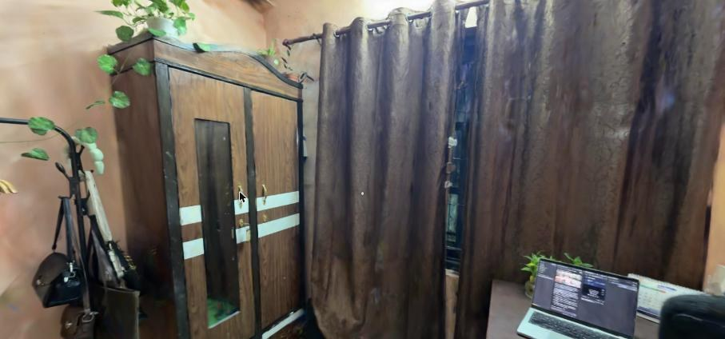

# AI-Based Indoor 3D Reconstruction & Spatial Experience Platform

[](https://github.com/prakrity26/ai-indoor-3d-reconstruction/releases/download/v1.0.0/img1299_walkthrough.mp4)

▶ **[Watch the 44-second walkthrough](https://github.com/prakrity26/ai-indoor-3d-reconstruction/releases/download/v1.0.0/img1299_walkthrough.mp4)** (no install needed)

Record a room with an ordinary smartphone, upload the video, and explore the reconstructed space as an interactive 3D scene in the browser. Add hotspots and saved viewpoints, then share a read-only link or embed the scene on a website.

```text
Capture → Upload → Process → Reconstruct → Explore → Edit → Save → Share
```

This is an internship engineering project. The reconstruction engine is a reusable module behind a REST API, so other company products can call it without the web platform.

**Status:** all 16 phases are implemented: the reconstruction pipeline (Phases 1–9), the API, job database, workers, web platform, Docker stack, CI, and documentation. Photoreal Gaussian splats are trained by a GPU worker (e.g. Colab) connected through a token-protected gateway; see [Photoreal splats on a GPU](#photoreal-splats-on-a-gpu). See [PROGRESS.md](PROGRESS.md).

| | |
|---|---|
| GitHub | https://github.com/prakrity26/ai-indoor-3d-reconstruction |
| Progress log | [PROGRESS.md](PROGRESS.md) |
| Project report and demo slides | [report/](report/README.md) |
| Walkable splat sample | [`samples/img1299/`](samples/README.md): 561k Gaussians, trained on an RTX 4090 (Git LFS, 139 MB) · [walkthrough video](https://github.com/prakrity26/ai-indoor-3d-reconstruction/releases/download/v1.0.0/img1299_walkthrough.mp4) |
| Latest release | [v1.0.0](https://github.com/prakrity26/ai-indoor-3d-reconstruction/releases/tag/v1.0.0) |
| Mesh sample | [`samples/img7916/`](samples/README.md) (Git LFS) |

## Quick start

### Option A: laptop (SQLite, no Docker)

Requires Python 3.10+.

```bash
git lfs install && git clone git@github.com:prakrity26/ai-indoor-3d-reconstruction.git
cd ai-indoor-3d-reconstruction
python3.10 -m venv .venv && source .venv/bin/activate
pip install -e ".[dev,api,depth,cloud]"
python -m api                                   # http://127.0.0.1:8000
```

In a second terminal, start a worker so uploads get processed:

```bash
source .venv/bin/activate
python -m queue.workers --pipeline mesh         # Phases 1–9 on CPU / Apple MPS
```

The sample room is listed on the dashboard straight away. Uploads are processed by the worker; the Processing jobs page shows each stage live.

### Option B: Docker Compose (production layout)

```bash
cp .env.example .env            # change POSTGRES_PASSWORD
docker compose up -d --build    # first build downloads CPU PyTorch and Open3D
open http://localhost:8000
```

Every concern runs in its own container, built from one [`Dockerfile`](Dockerfile):

| Container | Image | What it runs |
|---|---|---|
| `api` | `indoor3d-api` (target `api`) | The whole web app: REST API, web platform, walk viewer · port 8000 |
| `postgres` | `postgres:16-alpine` | Projects and jobs (volume `postgres_data`); migrations apply on start |
| `redis` | `redis:7-alpine` | Wakes workers when a job arrives (optional) |
| `worker` | `indoor3d-worker` (target `worker`) | Mesh pipeline, Phases 1–9, on CPU |
| `worker-gateway` | `indoor3d-api` | Token-protected API for remote GPU workers · port 8001 · profile `gpu` |
| `gpu-worker` | `indoor3d-gpu-worker` (target `gpu-worker`) | Photoreal splats (COLMAP + Nerfstudio) on an NVIDIA GPU · profile `gpu` |

`docker compose --profile gpu up -d --build` adds the gateway and a GPU worker on a machine with the
NVIDIA Container Toolkit (set `WORKER_TOKEN` in `.env`). Uploads and outputs live in `./data` on the host.

## The web platform

Served by FastAPI at `/` (plain ES modules in [`ui/web/`](ui/web), no build step).

| Section | What it does |
|---|---|
| **Dashboard** | Project counts, recent projects, live processing jobs, capture tips |
| **My projects** | Search, filter by status, grid/list view; project page with video preview, input-quality warnings, reconstruction metrics, downloads, rename, retry, delete |
| **Create project** | Drag-and-drop upload with recording guidelines, in-browser checks (format, size, duration, resolution, orientation), name and description, upload progress |
| **Processing jobs** | Status, current stage and progress for every upload; retry failed jobs |
| **3D Studio** | Orbit / zoom / pan / reset / fullscreen / auto-rotate on the mesh; Walk mode on a Gaussian splat (see below); edit mode to place info markers, text labels, and image/video markers; saved camera viewpoints and a start view; background, exposure, and shadow settings; `Cmd/Ctrl+S` to save |
| **Shared scenes** | Public links, embed code, make private, reset link |
| **Settings** | Theme, default viewer mode, platform info (database, queue, upload limit) |

A shared scene opens at `/s/<token>` (read-only viewer with hotspots and views). `/embed/<token>` is the same viewer without chrome, for an `<iframe>`.

### Mesh vs. Gaussian splat

| Representation | Viewer | Use |
|---|---|---|
| Mesh (`mesh.glb`) | `<model-viewer>` (Orbit) | Explicit geometry, hotspots, compatibility with 3D tools |
| Gaussian splat (`point_cloud.ply`) | GaussianSplats3D (Walk) | Photoreal exploration; needs CUDA training |

They are different formats with different viewers. A splat is not rendered as a GLB mesh.

### Walk viewer

`/viewer?ply=/jobs/<id>/point_cloud.ply` ([`ui/splat_viewer.html`](ui/splat_viewer.html)) is the
first-person experience used by Walk mode, shared links, and embeds:

- **Walk**: W A S D or arrows at eye height with smooth acceleration, Shift to go faster, drag to look (no mouse capture), double-click to glide to a spot, Q/E to change eye height.
- **Phones**: left thumb is a joystick, right thumb looks, double-tap glides.
- **Orbit**: a dollhouse view of the whole space. **Tour**: a slow automatic walk-around.
- **HD** toggles view-dependent colour (spherical harmonics) and anti-aliasing for slower devices; ⛶ goes fullscreen; R resets.
- The room's up axis is detected automatically (COLMAP −Y vs. Nerfstudio +Z); the Studio's ↕ button overrides it.

## Photoreal splats on a GPU

The mesh is built on your machine. The photoreal, walkable **Gaussian splat** needs an NVIDIA GPU,
so it is trained by a **GPU worker** that can run anywhere, including a free Google Colab session.
Tick *Also train a photoreal Gaussian splat* when you upload (or press **Train photoreal splat**
on a project page), start a worker, and the splat appears in the 3D Studio's **Walk** mode.

```text
laptop: web platform :8000 · worker gateway :8001 ◄── cloudflared tunnel ── Colab: GPU worker
```

The worker gateway is a separate app with only the worker routes, protected by a token, so the
tunnel never exposes the platform itself.

**1. On your laptop**, in three terminals (with the venv active):

```bash
python -m api                                    # the platform, http://127.0.0.1:8000
```

```bash
export WORKER_TOKEN=$(python -c "import secrets; print(secrets.token_urlsafe(32))")
echo "$WORKER_TOKEN"                             # copy this for Colab
python -m api.worker_gateway                     # worker gateway on :8001
```

```bash
cloudflared tunnel --url http://localhost:8001   # prints https://<random>.trycloudflare.com
```

Keep the laptop **awake, lid open, and plugged in** until training finishes; if it sleeps, the
tunnel dies. In a spare terminal: `caffeinate -dims`.

**2a. On a rented GPU (recommended: RunPod RTX 4090 or A6000, about $0.70–0.90/hour, roughly
$1 per splat).** Run the `gpu-worker` image, or on a plain CUDA PyTorch pod:

```bash
apt-get update && apt-get install -y colmap ffmpeg git
pip install --ignore-installed blinker && pip install nerfstudio     # Ubuntu's blinker breaks the install
git clone https://github.com/prakrity26/ai-indoor-3d-reconstruction.git && cd ai-indoor-3d-reconstruction
pip install --no-deps -e . && pip install httpx "sqlalchemy>=2"
export WORKER_GATEWAY_URL=https://<random>.trycloudflare.com
read -rs WORKER_TOKEN && export WORKER_TOKEN                          # paste, Enter (hidden)
SPLAT_NUM_FRAMES=300 python -m queue.workers --pipeline splat --name runpod-4090
```

On an RTX 4090: COLMAP ~13 min, training ~20 min, upload a few minutes. Stop the pod afterwards.

**2b. In Colab** (free, slower, disconnects), open [`notebooks/colab_gpu_worker.ipynb`](notebooks/colab_gpu_worker.ipynb)
(File → Open notebook → GitHub → `prakrity26/ai-indoor-3d-reconstruction`), choose a GPU runtime,
run the cells (cell 3b builds the CUDA kernels once per session, or restores them from Drive),
and paste the tunnel URL and token when asked. Leave the last cell running.

**3. Watch it**: Processing jobs and the project page show *Estimating camera poses → Training
Gaussians · step N/30000 → Uploading*. On a T4, 30,000 steps take roughly 45–90 minutes. When it
finishes, open the project in the 3D Studio and switch to **Walk** (W A S D, Q/E for down/up). If
the room looks sideways, press the ↕ **Flip up direction** button and Save.

Details:

- Trainer: Nerfstudio **splatfacto** by default (`--backend gsplat` uses the in-repo trainer).
- A Colab disconnect is detected after `SPLAT_STALE_MINUTES` (default 20) without progress; press **Train again**.
- With `SPLAT_KEEP_ROOT` set (the notebook uses Google Drive), camera poses and training checkpoints are kept there, so a reconnected worker skips COLMAP and resumes training from the last checkpoint. Each finished splat is also copied there before upload.
- Frames are shrunk to `SPLAT_MAX_SIDE` (default 1600 px) before COLMAP, which runs on the CPU on Colab; full-size 4K frames made feature extraction alone take ~27 minutes.
- On a CUDA machine that shares the database, skip the gateway: `python -m queue.workers --pipeline splat`.
- Docker: `docker compose --profile gpu up -d worker-gateway` runs the gateway (set `WORKER_TOKEN` in `.env`).
- COLMAP threads are capped to the CPUs the container may use (`SPLAT_COLMAP_THREADS`, ≤ 16 by default). Rented pods expose every host core (96+), and one SIFT thread per core was OOM-killed.
- When COLMAP cannot connect every frame it writes several models (`sparse/0`, `1`, `2`…). Nerfstudio only reads `sparse/0`, which on IMG_1299 held 4 frames while `sparse/2` held 216; the trainer now picks the largest model.
- Jobs stop before training when COLMAP places fewer than `SPLAT_MIN_REGISTERED` (30%) of the frames, with filming advice instead of a useless splat.
- Filming matters most: a slow, overlapping walk (three loops at different heights) gives a far better splat than a fast pan.

## Architecture

```text
 Browser ── web platform (ui/web) ─┐
                                   ▼
                         FastAPI (api/)  ──  files on disk (data/)
                          │        │              ▲
                 PostgreSQL /    Redis (wake-up)  │
                 SQLite (jobs)     │              │
                          └────────┴──► Worker (queue/, shared/worker.py)
                                              │
                                   Reconstruction engine (model/)
              frames → keyframes → poses → depth → cloud → filter/fuse → mesh → labels → evaluation
```

- The API never runs reconstruction. It saves the upload (streamed to disk), creates a `queued` row, and serves files a worker wrote.
- The **database is the queue**. Workers claim the oldest queued row (`SKIP LOCKED` on Postgres). Redis, when configured, only wakes workers early.
- Workers report the current stage and percentage; the UI polls it. Jobs stuck in `running` after a crash or `docker stop` are marked failed and can be retried.
- Studio documents (hotspots, viewpoints, settings) are validated JSON in `data/jobs/_studio/<job_id>.json`.

## REST API

| Method & path | Purpose |
|---|---|
| `GET /health` · `GET /api/config` | Liveness; upload limit, formats, database and queue type |
| `GET /jobs` · `POST /jobs` | List projects · upload a video (`file`, `name`, `description`) |
| `GET /jobs/{id}` · `PATCH /jobs/{id}` · `DELETE /jobs/{id}` | Read (with stage, progress, input warnings, artifacts) · rename/describe · delete everything the job wrote |
| `POST /jobs/{id}/retry` | Re-queue a failed job |
| `POST /jobs/{id}/splat` | Queue (or re-queue) photoreal splat training for a GPU worker |
| `GET\|PUT /jobs/{id}/studio.json` | Hotspots, viewpoints, scene settings |
| `PUT /jobs/{id}/visibility` · `POST /jobs/{id}/share/rotate` | `private` / `public`; issue a new share token |
| `GET /shared/{token}` | Public, read-only project + studio document |
| `GET /jobs/{id}/mesh.glb` · `point_cloud.ply` · `scene.json` · `evaluation.json` · `thumbnail.jpg` · `source` | Files |

Interactive docs: http://127.0.0.1:8000/docs. The worker gateway (`python -m api.worker_gateway`, bearer token) serves `POST /worker/claim`, `GET /worker/jobs/{id}/source`, `POST /worker/jobs/{id}/progress`, `PUT /worker/jobs/{id}/result`, and `POST /worker/jobs/{id}/fail`.

## Reconstruction pipeline (CLI)

Each phase also runs on its own. Put **your own** indoor video in `data/uploads/`.

```bash
python -m model.preprocessing data/uploads/your_room.mp4   # 1 validate, extract frames
python -m model.frame_selection data/frames/<job_id>       # 2 keyframes
python -m model.camera data/frames/<job_id>                # 3 relative poses
python -m model.depth data/frames/<job_id>                 # 4 Depth Anything (needs .[depth])
python -m model.reconstruction data/frames/<job_id>        # 5 back-projected cloud
python -m model.pointcloud data/frames/<job_id>            # 6 filter + voxel fusion (needs .[cloud])
python -m model.mesh data/frames/<job_id>                  # 7 Poisson mesh → GLB/PLY
python -m model.scene_understanding data/frames/<job_id>   # 8 object labels (.[detect] optional)
python -m model.evaluation data/frames/<job_id>            # 9 evaluation.json
```

Gaussian splats need an NVIDIA GPU and run in a GPU worker (`python -m queue.workers --pipeline splat`); see [Photoreal splats on a GPU](#photoreal-splats-on-a-gpu) and [`model/splat/`](model/splat/README.md).

**Scale is relative**, not metres: monocular video has no metric scale.

## Testing

```bash
pip install -e ".[dev,api,db,queue,cloud]"
python -m ruff check .
python -m pytest -q
```

CI ([`.github/workflows/ci.yml`](.github/workflows/ci.yml)) lints, runs the test suite, syntax-checks the frontend modules, and builds and smoke-tests the API image. See [CONTRIBUTING.md](CONTRIBUTING.md) for conventions and where changes go.

## Repository layout

```text
api/          FastAPI app, artifact lookup, studio document validation
ui/web/       Web platform (index.html, share.html, assets/)
ui/           Walk viewer (splat_viewer.html) and mesh orbit viewer served by the API
model/        Reconstruction engine (Phases 1–9) and the splat trainer
database/     SQLAlchemy model, repository, versioned SQL migrations
queue/        Worker entry point (python -m queue.workers)
shared/       Job store, worker loop, broker, settings
samples/      Checked-in sample reconstruction (Git LFS)
notebooks/    Colab GPU notebooks for splat training
tests/        pytest suite
Dockerfile    api, worker and gpu-worker targets
docker-compose.yml  api, postgres, redis, worker; gateway + gpu-worker in the "gpu" profile
```

## Configuration

Copy `.env.example` to `.env`. Key settings: `DATABASE_URL` (empty → SQLite in `data/jobs/`), `REDIS_URL` (optional), `MAX_UPLOAD_MB`, `COMPUTE_DEVICE` (`auto` / `mps` / `cuda` / `cpu`), `MESH_POISSON_THREADS`, `WORKER_STALE_MINUTES`.

## Known limitations

- **No authentication.** Single-user mode. "Private" means "no share link"; file URLs are not access-controlled. Put the app behind a trusted network or add auth before exposing it publicly.
- Mesh quality is coarse and can look incomplete; scale is relative.
- In splats, plain walls, ceilings and floors look smeared while textured objects are sharp: a camera-only method has no detail to match on a uniform surface. Why, and how it can be fixed: [report §8.1](report/PROJECT_REPORT.md#81-why-plain-walls-and-floors-look-smeared).
- Walkable splats need an NVIDIA GPU (the `gpu-worker` image, a rented GPU, or Colab); the CPU `worker` runs only the mesh pipeline.
- The splat viewer (GaussianSplats3D) did not render in the WebKit-based preview browser used during development; use a current Chrome, Edge, or Firefox for Walk mode.
- Hotspots are placed on the mesh (Orbit mode), not inside the splat viewer.
- Media markers link to images/videos by URL; files are not uploaded to the platform.
- 360° video is out of scope for this version.

## Future work

Authentication and teams · uploading media for hotspots · hotspots in Walk mode · QR-code sharing · 360° capture · metric scale from known objects · collaboration.

## License

MIT. See [LICENSE](LICENSE).
