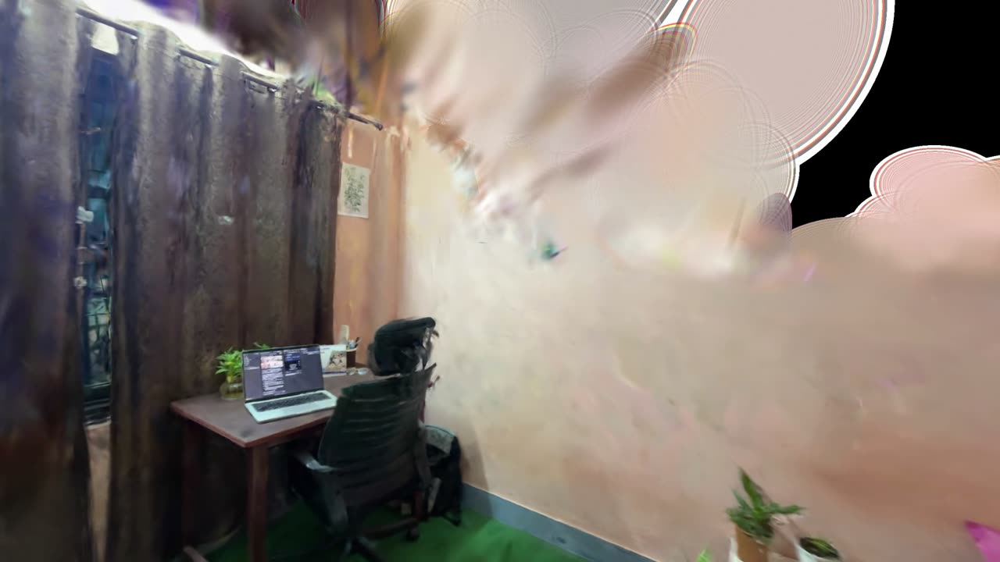

# model/splat

Photoreal, walkable Gaussian splats. The mesh pipeline (Phases 1–9) runs on any machine; this
package needs an NVIDIA GPU and runs inside a **GPU worker** (`python -m queue.workers --pipeline splat`).

## Backends

| Backend | Module | Status | Used by |
|---|---|---|---|
| `splatfacto` (default) | [`splatfacto.py`](splatfacto.py) | **Production.** Nerfstudio's standard phone-video recipe. | GPU worker, `gpu-worker` image, Colab notebook, RunPod |
| `gsplat` | [`pipeline.py`](pipeline.py), [`train.py`](train.py), [`colmap.py`](colmap.py), [`prepare.py`](prepare.py) | Experimental in-repo trainer. Produced sparse ~1 MB clouds on phone video. | `--backend gsplat` only |

## splatfacto pipeline

```text
video ─ffmpeg→ 300 frames ≤ 1600 px ─COLMAP→ camera poses ─ns-train→ 3D Gaussians ─ns-export→ point_cloud.ply
```

`train_splatfacto()` reports each stage to the job (Processing jobs and the project page show it)
and guards against what broke on real captures:

| Problem seen | Handling |
|---|---|
| COLMAP split the frames into several models and Nerfstudio read the smallest (`sparse/0`) | Rebuilds `transforms.json` from the largest model |
| Too few frames placed (bad footage) | Stops before training with filming advice (`SPLAT_MIN_REGISTERED`, 30%) |
| COLMAP OOM-killed on cloud pods that expose 96+ cores | Caps COLMAP threads (`SPLAT_COLMAP_THREADS`, ≤ 16) |
| `ns-export` failed on PyTorch ≥ 2.6 (`weights_only`) | Sets `TORCH_FORCE_NO_WEIGHTS_ONLY_LOAD=1` for its own checkpoints |
| gsplat's CUDA build ran out of memory | `MAX_JOBS=2` (the `gpu-worker` image prebuilds the kernels) |
| A disconnect lost an hour of work | With `SPLAT_KEEP_ROOT`, poses and checkpoints persist and the next run resumes |

Settings (`.env.example`): `SPLAT_NUM_FRAMES`, `SPLAT_TRAIN_STEPS`, `SPLAT_MAX_SIDE`,
`SPLAT_MIN_REGISTERED`, `SPLAT_COLMAP_THREADS`, `SPLAT_KEEP_ROOT`.

## Running a worker

See the root README, *Photoreal splats on a GPU*: a rented GPU (RunPod), the `gpu-worker` Docker
image, or [`notebooks/colab_gpu_worker.ipynb`](../../notebooks/colab_gpu_worker.ipynb).

## Known limitation: plain walls and floors



Textured objects reconstruct sharply; plain walls, ceilings and floors come out smeared or with
floating Gaussians. COLMAP's SIFT features need distinctive detail, so a uniform wall gets almost
no sparse points. Splatfacto initialises Gaussians from those points, so wall Gaussians start in
the wrong place. The photometric loss can't correct them, because a blob at the wrong depth on a
uniform wall still matches the training views. Fewer, darker frames of the walls make it worse.

Mitigations, none implemented yet: better capture (lighting, wall-facing passes, temporary
texture), depth-supervised training from Depth Anything, plane-aware splatting (2DGS, PGSR),
learned matchers (SuperPoint + LightGlue), LiDAR depth, and floater pruning. Details and
trade-offs: [report/PROJECT_REPORT.md §8.1](../../report/PROJECT_REPORT.md#81-why-plain-walls-and-floors-look-smeared).

## Filming

Training cannot fix footage COLMAP cannot place. Hold the phone horizontally, walk slowly along
the walls looking into the room (never spin on the spot), keep furniture in every frame, stay a
metre from surfaces, light the room well, and do two loops at different heights. 1–2 minutes is enough.
