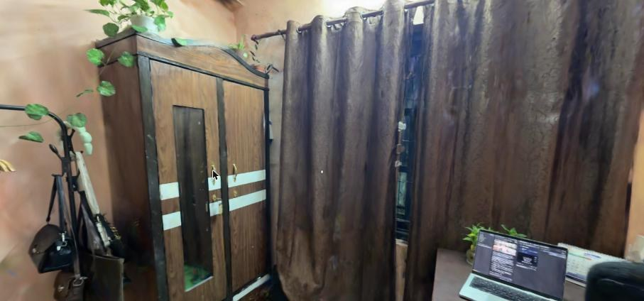

# Project report: AI-based indoor 3D reconstruction

**Intern:** Prakriti Khanal · **Period:** 21 August – 25 November 2026  
**Repository:** https://github.com/prakrity26/ai-indoor-3d-reconstruction  
**Slides:** [`report/slides/`](slides/) (the source of the demo deck; see [report/README.md](README.md))

## 1. Summary

The project turns an ordinary smartphone video of a room into a 3D scene you can explore in a
web browser, in the style of Captures Studio or Matterport. A user uploads a video on the web
platform, a background worker reconstructs the room, and the result opens in a 3D viewer that can
be shared by link.

All 16 planned phases are finished. On top of them, the project now produces **photoreal,
walkable Gaussian splats** on a rented cloud GPU. The sample in `samples/img1299/` was made from
one 109-second iPhone video:

| Measure | Value |
|---|---|
| Gaussians in the scene | 561,314 |
| Frames sampled / placed by COLMAP | 300 / 216 |
| Training | 30,000 steps, Nerfstudio splatfacto, ~7 minutes on an RTX 4090 |
| File | `point_cloud.ply`, 139 MB, stored with Git LFS |
| Total cloud GPU cost | $1.62 (RunPod) |



▶ **[Watch the 44-second walkthrough video](https://github.com/prakrity26/ai-indoor-3d-reconstruction/releases/download/v1.0.0/img1299_walkthrough.mp4)**, a screen recording of the walk viewer attached to the [v1.0.0 release](https://github.com/prakrity26/ai-indoor-3d-reconstruction/releases/tag/v1.0.0).

## 2. What the system does

```text
Capture → Upload → Process → Reconstruct → Explore → Edit → Save → Share
```

1. **Capture.** The user films the room with a phone.
2. **Upload.** The web platform checks the file (type, size, length, resolution, brightness, blur) and creates a project.
3. **Process.** The API stores the video and writes a job to the database. It never does the reconstruction itself.
4. **Reconstruct.** A worker picks up the job and runs either the mesh pipeline (CPU) or the splat pipeline (GPU), reporting progress stage by stage.
5. **Explore.** The 3D Studio shows meshes; the walk viewer gives a first-person walk through splats.
6. **Edit, save, share.** Hotspots and saved viewpoints, then a read-only share link or website embed.

There are two kinds of output:

- **Mesh (Phases 1–9).** Runs on any computer. Coarse but measurable geometry.
- **Gaussian splat (GPU worker).** Photoreal and walkable. Needs an NVIDIA GPU.

## 3. Technology used

### Computer vision and AI

| Tool | Use in the project |
|---|---|
| ffmpeg, OpenCV | Frame extraction, video quality checks, keyframe selection, ORB feature matching for camera poses (mesh path) |
| COLMAP | Structure-from-Motion: finds the camera position of every frame (splat path) |
| Depth Anything V2 (PyTorch, Hugging Face Transformers) | Monocular depth estimation for each keyframe |
| Open3D | Point-cloud filtering, voxel fusion and Poisson surface reconstruction |
| YOLOv8 (Ultralytics) | Indoor object labels (`scene.json`) |
| Nerfstudio splatfacto | Trains the Gaussian splat and exports it as a PLY |
| gsplat, PyTorch, CUDA | GPU kernels underneath splat training |

### Backend

| Tool | Use |
|---|---|
| Python 3.10 | All backend code |
| FastAPI, Uvicorn | REST API: projects, uploads, jobs, files, studio documents, sharing |
| SQLAlchemy | Database access; versioned migrations in `database/migrations/` |
| PostgreSQL / SQLite | Job and project storage (Postgres in Docker, SQLite on a laptop) |
| Redis | Optional wake-up signal for workers |
| Worker gateway (`api/worker_gateway.py`) | Token-protected endpoint so a remote GPU can claim jobs and upload results |
| Cloudflare quick tunnel | Exposes the gateway to a cloud GPU during development |

### Frontend

| Tool | Use |
|---|---|
| Plain JavaScript ES modules, HTML, CSS | Web platform with seven sections (Dashboard, My projects, Create project, Processing jobs, 3D Studio, Shared scenes, Settings); no build step |
| Three.js | 3D rendering |
| GaussianSplats3D | Splat rendering in the browser |
| `ui/splat_viewer.html` | First-person walk viewer: WASD and mouse, touch joystick, Walk / Orbit / Tour, HD toggle |

### Infrastructure and engineering

| Tool | Use |
|---|---|
| Docker | One `Dockerfile`, three targets: `api`, `worker` (CPU mesh), `gpu-worker` (CUDA 12.4 + Nerfstudio) |
| Docker Compose | API, Postgres, Redis, workers and the gateway as separate containers; GPU worker behind the `gpu` profile |
| RunPod | Rented GPU used to train the sample splat |
| Google Colab | Alternative GPU worker (`notebooks/colab_gpu_worker.ipynb`) |
| Git, GitHub, Git LFS | Version control; large 3D samples in LFS |
| GitHub Actions | CI: Ruff lint, 116 pytest tests, frontend syntax check, Docker build and smoke test |
| pytest, Ruff | Tests (with stand-ins for COLMAP, Nerfstudio and ffmpeg) and linting |

## 4. Timeline

| Date | Work |
|---|---|
| 21 Aug | Project structure (Phase 0); video validation and frame extraction (Phase 1) |
| 7–10 Sep | Keyframe selection (2), camera poses (3), monocular depth (4), initial point cloud (5) |
| 15–17 Sep | Point-cloud filtering and fusion (6); Poisson mesh and GLB export (7); first in-repo splat trainer |
| 28 Sep | Sample mesh (`samples/img7916/`) and local viewers published for review |
| 26 Oct | Object labels (8) and evaluation report (9) |
| 23 Nov | API, job database and worker (10–12); web platform (13); Docker (14); hardening and CI (15); documentation (16) |
| 23 Nov | Remote GPU splat worker; first walkable splat (`samples/img1299/`); new walk viewer; production container layout; repository clean-up |
| 25 Nov | This report and the demo slides |

The full commit history is on GitHub; `PROGRESS.md` holds the phase-by-phase status.

## 5. Photoreal splat work in detail

The splat pipeline (`model/splat/splatfacto.py`) is:

```text
video ─ffmpeg→ 300 frames ≤ 1600 px ─COLMAP→ camera poses ─ns-train→ Gaussians ─ns-export→ point_cloud.ply
```

The GPU worker (`python -m queue.workers --pipeline splat`) runs on any NVIDIA machine, claims a
job through the worker gateway, trains, and uploads the PLY. Progress and failures appear on the
Processing jobs page and in notifications.

### Problems found on real footage, and the fixes now in the code

Each fix has an automated test in `tests/test_splat_worker.py` or `tests/test_api_ui.py`.

| Problem | Cause | Fix |
|---|---|---|
| Training used only 4 of 300 frames | COLMAP split the frames into four separate models (2, 13, 89 and 216 frames); Nerfstudio reads only `sparse/0` | Count the frames in every model and rebuild `transforms.json` from the largest |
| COLMAP was killed for running out of memory | Cloud containers report all 96 host cores and COLMAP started one SIFT thread per core | A wrapper caps COLMAP to the CPUs the container may use (`SPLAT_COLMAP_THREADS`, at most 16) |
| `ns-export` failed after training | PyTorch 2.6 changed `torch.load` to `weights_only=True` | Set `TORCH_FORCE_NO_WEIGHTS_ONLY_LOAD=1` for Nerfstudio's own checkpoints |
| A failure could delete finished training | The worker removed its work folder on error | `SPLAT_KEEP_ROOT` keeps poses and checkpoints and the next run resumes |
| Bad videos wasted GPU time | Footage COLMAP cannot place still went to training | Stop before training when under 30% of frames are placed, with filming advice |
| Viewer opened inside floating noise, facing a wall | Bounding-box framing ignored where the phone was | Start at the capture position and face the most detailed direction |
| The first sample (`IMG_7916`) never trained well | Vertical video, too little overlap | Refilmed horizontally as `IMG_1299` |

### Cost and time

The sample cost **$1.62** of RunPod time in total. Part of that was setup and two mistakes made
along the way (a worker that sat idle for about 25 minutes, and results lost when the export failed); both causes are fixed above. Training itself took about 7
minutes on an RTX 4090.

## 6. Production layout

| Container | Image | Role |
|---|---|---|
| `api` | `indoor3d-api` | Web platform, REST API, viewers (port 8000) |
| `postgres` | `postgres:16-alpine` | Projects and jobs |
| `redis` | `redis:7-alpine` | Wakes workers |
| `worker` | `indoor3d-worker` | Mesh pipeline on CPU |
| `worker-gateway` | `indoor3d-api` | Lets remote GPU workers claim jobs (port 8001; `--profile gpu`) |
| `gpu-worker` | `indoor3d-gpu-worker` | Splat training on an NVIDIA GPU (`--profile gpu`) |

Run everything with `docker compose up -d --build`, or locally with `python -m api`.

## 7. Repository clean-up for review

Before the review the repository was tidied so a new developer can follow it:

- Removed superseded code: two malformed one-off notebooks, the old Streamlit client and standalone demo viewers (all still in git history).
- Added Ruff linting to `pyproject.toml` and CI, and fixed every finding.
- Merged duplicated database setup in the API and gateway into `shared.jobs.default_store`.
- Added `CONTRIBUTING.md`; rewrote `model/splat/README.md`; removed six unused settings from `.env.example`.
- CI now downloads only the small LFS sample, so the 139 MB splat does not use up GitHub's free 1 GB/month LFS bandwidth.

## 8. Limitations

- **No real-world scale.** A single phone video gives relative, not metric, measurements.
- **GPU worker is started by hand.** A GPU machine is rented and started for each training run.
- **Footage matters.** Vertical, fast or spinning videos may not reconstruct; the app now stops early and explains why.
- **Splat size.** 139 MB is heavy for mobile data.
- **Mesh quality.** The CPU mesh is coarse; the splat is the photoreal output.

## 9. Suggested next steps

1. Run the `gpu-worker` image on an always-on or on-demand cloud GPU so uploads train with no manual steps.
2. Add metric scale (a reference object, or the phone's LiDAR where available).
3. Compress splats for faster loading on phones.
4. Give live filming guidance in the capture flow.

## 10. How to run the demo

```bash
source .venv/bin/activate
git lfs pull --include "samples/img1299/*"   # first time only: the 139 MB splat
python -m api                                 # open http://127.0.0.1:8000
```

Open **Sample room (IMG_1299)** on the dashboard and choose **Walk the room**. Controls: WASD
or arrows to move, drag to look, Shift to run, Q/E for height, double-click to glide.
