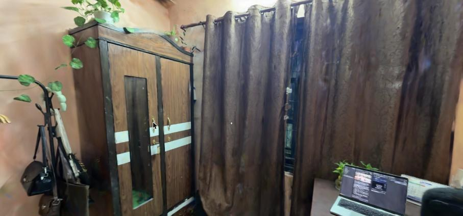

# Sample reconstruction outputs

These files are stored with **Git LFS**. After clone, run `git lfs install` (or `git lfs pull`) if the GLB/PLY files are tiny pointer text instead of 3D binaries.

## Job `img_1299`: photoreal walkable splat

A bedroom filmed on an iPhone (landscape, ~109 s), trained into a Gaussian splat on a RunPod
RTX 4090. COLMAP placed 216 of 300 sampled frames; splatfacto ran 30,000 steps in about 7 minutes.

| File | What it is |
|------|------------|
| `img1299/point_cloud.ply` | 3DGS splat, 561,314 Gaussians, SH degree 3, up axis +Z (139 MB) |
| `img1299/manifest.json` | Capture, COLMAP and training details |
| `img1299/preview/` | Screenshots from the walk viewer |



### Walk through it

```bash
git lfs pull --include samples/img1299/point_cloud.ply
python -m api                      # then open:
open "http://127.0.0.1:8000/viewer?ply=/jobs/img1299/point_cloud.ply"
```

It is also listed on the dashboard as *Sample room (IMG_1299)*: open it and choose **Walk**. Use a
current Chrome, Edge or Firefox.

## Job `img7916`

Indoor clip `IMG_7916` reconstructed through Phases 1–7 (mesh path). OpenCV posed 17 of 70 keyframes, so the surface is incomplete.

| File | What it is |
|------|------------|
| `img7916/mesh.glb` | Poisson mesh for orbit preview (~17k vertices, ~34k triangles) |
| `img7916/mesh.ply` | Same mesh as PLY |
| `img7916/cloud_filtered.ply` | Filtered / voxel-fused point cloud (~80k points) |
| `img7916/preview/` | A few source frames from the clip |

Relative monocular scale. Not a walkable photoreal splat.

### View on a laptop

```bash
python -m ui.demo --job-id img7916
```

Opens http://127.0.0.1:8765/ (mesh orbit). Works from this `samples/` copy after a GitHub clone.

COLMAP could place only a handful of this vertical clip's frames, so it has no splat. The
landscape `img_1299` capture above is the walkable example.
